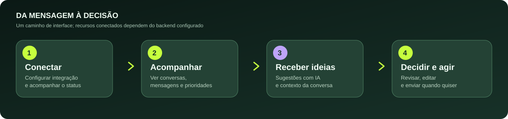
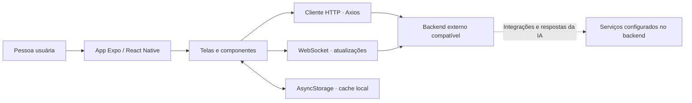

<div align="center">


# Saraiva.AI

**Converse com contexto. Aja com clareza.**

Interface mobile para organizar conversas, acompanhar relacionamentos e apoiar respostas com inteligência artificial.

[**Começar**](#-comece-aqui) · [**Como funciona**](#-como-funciona) · [**Recursos**](#-o-que-você-encontra) · [**Arquitetura**](#-arquitetura) · [**Documentação**](#-documentação)


</div>


> **Sobre este repositório**  
> Este projeto reúne o **aplicativo React Native/Expo**. A experiência de conversas, sugestões e agentes usa **serviços externos de API HTTP e WebSocket**. O backend não está incluído aqui. A presença de uma tela ou integração no código não confirma que ela esteja disponível sem configurar um serviço compatível.

## ✨ O que você encontra

| Experiência | O que a interface oferece | Onde está no código |
| --- | --- | --- |
| 💬 **Conversas** | Lista de chats, agrupamentos, detalhes e acompanhamento de mensagens | `src/screens/ConversasScreen.tsx`, `src/screens/ChatScreen.tsx` |
| ✦ **Sugestões com IA** | Respostas sugeridas que podem ser revisadas e editadas antes do envio | `src/components/InlineSuggestions.tsx`, `src/screens/ChatScreen.tsx` |
| 🎯 **Missões e agentes** | Visualização e gestão de missões com modos de operação previstos na API | `src/screens/MissoesScreen.tsx`, `src/services/api.ts` |
| 📊 **Painel** | Indicadores e destaques de relacionamento | `src/screens/PainelScreen.tsx` |
| 🔗 **Conexão** | Interface para solicitar código de conexão e conferir o status | `src/screens/ConexaoScreen.tsx` |
| 🎓 **Coach de comunicação** | Tela de insights sobre padrões de conversa, quando fornecidos pela API | `src/screens/CoachScreen.tsx` |
| 💾 **Cache local** | Persistência local de conversas e mensagens para reduzir a dependência de carregamento contínuo | `src/services/cache.ts` |

**Importante:** os recursos acima estão **representados no frontend**. O comportamento ponta a ponta depende dos endpoints, credenciais, dispositivos e serviços conectados. Este README não promete automação autônoma nem conectividade garantida.

## 🧭 Como funciona

<div align="center">
  
</div>

A proposta é colocar a pessoa no centro da experiência: a IA ajuda a interpretar, sugerir e priorizar, mas a interface também permite **revisar antes de enviar**. Esse diagrama representa a jornada prevista pela interface, não um teste de integração em produção.

## 🚀 Comece aqui

### Pré-requisitos

- **Node.js** com npm, em versão compatível com o Expo SDK 54.
- Ambiente para executar **Expo** e um dispositivo ou emulador Android/iOS.
- **Backend compatível** se quiser experimentar dados reais, conversas, sugestões e conexão de mensagens.

### 1. Instale e abra

```bash
git clone https://github.com/saraivabr/saraiva-ai-app.git
cd saraiva-ai-app
npm install
npm start
```

O comando `npm start` executa `expo start`. Use o menu do Expo para abrir a aplicação no ambiente disponível. Dependendo das bibliotecas nativas, você pode precisar de um development build em vez do Expo Go.

### 2. Execute uma plataforma, se necessário

```bash
npm run android  # expo run:android
npm run ios      # expo run:ios (exige ambiente macOS/iOS)
```

O projeto também declara `npm run web`, mas a execução no navegador **não foi validada nesta revisão** e pode exigir dependências adicionais.

### 3. Configure a conexão com seu backend

Os endereços atuais ficam em `app.json` na propriedade `expo.extra`:

```json
{
  "extra": {
    "apiUrl": "https://SEU_BACKEND/api",
    "wsUrl": "wss://SEU_BACKEND/ws"
  }
}
```

O código lê esses valores em `src/services/api.ts` e `src/hooks/useWebSocket.ts`; ambos também incluem URLs de fallback no código. **Configure os dois para o seu ambiente de confiança antes de usar dados reais.** Não salve tokens, senhas ou chaves privadas em `app.json` nem em commits.

### 4. Faça um primeiro reconhecimento

Abra a aplicação e percorra as abas **Conversas**, **Missões**, **Painel**, **Conexão**, **Coach** e **IA**. Sem um backend funcional, chamadas remotas podem falhar ou retornar estados vazios. Telas de **Status** e **Chamadas** existem apenas como placeholders indicados com “em breve”.

## 🏗️ Arquitetura



| Camada | Arquivos principais | Responsabilidade |
| --- | --- | --- |
| Navegação | `App.tsx` | Abas e rotas da aplicação |
| Telas | `src/screens/` | Experiências de conversas, missões, IA e painéis |
| UI | `src/components/`, `src/design-system/` | Componentes, interações e tokens |
| HTTP | `src/services/api.ts` | Endpoints, tipos e tratamento de erros |
| Tempo real | `src/hooks/useWebSocket.ts` | Eventos e reconexão via WebSocket |
| Persistência | `src/services/cache.ts` | Cache local com AsyncStorage |

### Stack identificada

**Expo 54**, **React Native 0.81**, **React 19**, **TypeScript 5.9**, **React Navigation 7**, **Axios**, **AsyncStorage**, **expo-blur**, **expo-haptics** e **react-native-reanimated**. As versões exatas e dependências devem ser consultadas em [package.json](./package.json).

## 🎨 Identidade e componentes

O código combina a linguagem de aplicativos de mensagens com destaques para recursos de IA. Existem tokens de verde, roxo, superfícies, tipografia e espaçamento em `src/design-system/tokens/` e `src/theme/whatsapp.ts`.

A **capa e o fluxograma desta documentação são ilustrações editoriais**, não capturas do aplicativo. Screenshots reais devem ser adicionados apenas depois de executar a interface em um ambiente verificável, sem informações de contatos reais.

## 📚 Documentação

- [Plano de aprimoramento](./docs/PLANO_APRIMORAMENTO.md): propostas de evolução.
- [Plano de IA Agente](./docs/PLANO_IA_AGENTE.md): ideias de backend e ferramentas; **documento de planejamento**, não confirmação de implementação.
- [Plano do design system](./docs/plans/2026-01-26-design-system.md): detalhamento de componentes.
- [Guia para manter este README](./docs/README_STYLE.md): padrão visual e regras para documentação futura.

## 🔍 Estado e limites do projeto

- **Frontend presente:** navegação, telas, componentes, integração HTTP/WebSocket e cache local.
- **Dependência externa:** funcionamento de conversas, agentes e recursos de IA requer serviços de backend compatíveis.
- **Sem garantia de deploy:** esta documentação não comprova disponibilidade em lojas de aplicativos, CI aprovado ou operação em produção.
- **Testes:** não há script `test` configurado no `package.json` deste repositório. Para inspecionar tipos, experimente `npx tsc --noEmit` no seu ambiente.
- **Licença:** não foi identificado arquivo `LICENSE` na raiz. Não presumir licença MIT apenas porque o README anterior a mencionava.

## 🤝 Contribuições

Correções de documentação, acessibilidade e melhorias de interface são bem-vindas via **pull request**. Para contribuir com segurança, mantenha credenciais fora do repositório, descreva como reproduzir mudanças e **não inclua dados reais de conversas** em exemplos, screenshots ou logs.

<div align="center">

**Saraiva.AI** · Tecnologia para ampliar a capacidade humana de perceber, decidir e agir.

[GitHub @saraivabr](https://github.com/saraivabr) · [Site Saraiva.AI](https://saraiva.ai)

</div>
